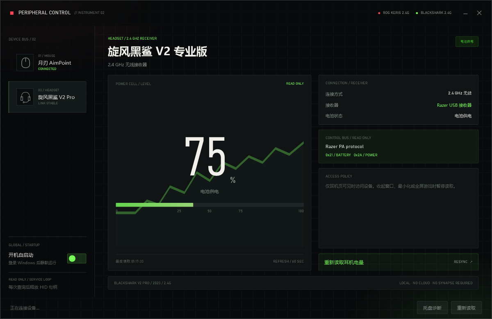

# ROG Mouse Control Center / ROG 月刃 控制中心

A lightweight, single-exe replacement for ASUS Armoury Crate for the **ROG Keris Wireless AimPoint**
(and compatible ASUS ROG mice). Talks the ASUS private HID protocol directly to adjust DPI, polling
rate, debounce time and angle snapping, and reads the battery — no Armoury Crate, no drivers,
no .NET SDK, no third-party runtime.

It also has a read-only **耳机** page for the **Razer BlackShark V2 Pro (2023) over its 2.4 GHz
receiver** (`1532:0555`). That page reads the level and the receiver's charging-path byte; it does
not configure EQ, microphone, THX, lighting, or firmware. Bluetooth is not used.

The redesigned shell uses a persistent device rail for `鼠标` and `耳机`, with the ROG mouse in
signal red and the Razer headset in signal green. Mouse battery telemetry stays inside the mouse
workspace; global launch-at-logon lives in the rail footer.

Windows 10/11 · .NET Framework 4.x (preinstalled) · x86 single file · ~600 KB

> Unofficial community project. Not affiliated with, endorsed by, or supported by ASUSTeK.
> Use at your own risk — it writes settings into the mouse's onboard firmware.




> 中文说明见 [README.zh-CN.md](README.zh-CN.md)

## Why

Armoury Crate installs several services and ~175 MB of background processes just to change a DPI
value. This tool opens the vendor HID collection only when the window is visible, sends one short
command per minute, and **releases the device handle entirely** while the window is hidden or a
fullscreen game is running — so it never competes with the pointer for its own HID link.

## Features

- **DPI** — 4 onboard stages, 50-step adjustment, one-click presets (400/800/1600/2400/3200)
- **Polling rate** — 125 / 250 / 500 / 1000 Hz
- **Debounce** — 4–32 ms
- **Angle snapping** — on/off
- **Dual battery tray icon** — the outer red ring is the ROG mouse, the inner green ring is the
  Razer headset; tooltip and menu show both values
- **Instant apply** — every change is written to the mouse and saved to firmware, no "Save" button
- **Launch at logon** — in-app switch and tray menu item, per-user HKCU Run key, no admin rights;
  logon starts silently in the tray, while a manual launch still opens the window
- **Single instance** — launching again surfaces the running window instead of starting a second poller
- **Stutter-safe** — device access is suspended whenever the window is hidden/minimized or a
  fullscreen app is in the foreground
- **Razer headset level** — switch to `耳机`; the selected page reads once immediately and every
  60 seconds while visible, then releases the shared HID collection after each transaction

## Usage

Download the exe from [Releases](../../releases) and run it. No installation.

> Windows may show a SmartScreen warning because the exe is not code-signed. Choose
> "More info" → "Run anyway", or build it yourself (see below).

| Action | Effect |
| --- | --- |
| Click a stage chip | Switches the mouse to that DPI stage **and** writes it to firmware |
| Drag slider / wheel / +- | Adjusts the current stage in 50 DPI steps, writes on release |
| "常用" row | Sets the current stage to 400/800/1600/2400/3200 |
| Polling rate / debounce / angle snapping | Applied and saved immediately |
| Close button / ESC | Hides to tray; the program stops touching the device completely |
| Tray icon | Dual ring: outer red = mouse, inner green = headset; tooltip shows both levels |
| Tray right-click | Show window / Open mouse or headset page / Re-read both devices / **Launch at logon** / Quit |
| "托盘诊断" button | Writes tray registration status and icon coordinates to the footer and `tray.log` |
| `耳机` tab | Read-only BlackShark V2 Pro 2.4 GHz battery and charging-path status |

## Razer BlackShark V2 Pro (2.4 GHz)

The headset is recognized only when the HID collection exposes Razer VID `1532`, PID `0555`, a
product string containing `BlackShark V2 Pro`, and vendor usage page `0xFF00`. The collection is
opened shared, so Razer Synapse can stay open; it is released after every read.

The headset does **not** use the 90-byte Razer mouse report. It uses the 64-byte "PA" exchange:

| Command | Purpose |
| --- | --- |
| remote `0xE1` | select/exit the control session before and after a query |
| `0x21` | battery level, 0–100 in the ACK payload |
| `0x2A` | charging path: `0` on battery, non-zero on the cable |

The receiver sends unrelated `PI` status frames before the ACK, so the transport keeps reading
until the command echo matches or the bounded window expires. A missing ACK is shown as
`接收器在线 · 耳机未响应`, never as 0%. A level outside 0–100 is rejected. A non-zero charging
byte is shown as `已连接充电线`, not as a claim that the cells are actively charging near 100%.

Battery polling runs only while the `耳机` page is selected, the window is visible and not minimized,
and no fullscreen app is foregrounded. The handle is closed before the next timer tick.

Protocol facts were cross-checked against HaloBattery's MIT-licensed `providers/blackshark.py`
and OpenRazer PR #2862 for `1532:0555`. This implementation uses only the protocol facts; it does
not copy the reference driver or bundle Razer software. The protocol is unofficial.

## Device access policy (why it does not cause stutter)

| State | Vendor HID handle | Polling |
| --- | --- | --- |
| Window visible, no fullscreen app | open | 1 battery command (~4–5 ms) per 60 s; full read every 5 min |
| Window hidden / minimized / in tray | **released** | stopped, except one 4–5 ms battery read per 5 min to keep the tray ring honest |
| Fullscreen app in foreground | **released** | stopped entirely, including the tray keep-alive |

Fullscreen detection is one `GetForegroundWindow` + rectangle + window-style read every 3 s
(no device access), so a fullscreen game never sees traffic from this program.

## Tray icon and integrity level

Windows only lets processes at **Medium integrity or above** add tray icons. If the exe sits in a
folder carrying a Low mandatory label, `Shell_NotifyIcon` fails with `ERROR_ACCESS_DENIED (5)` and
the only symptom is a missing icon. If that happens, click "托盘诊断": the footer reports the
current integrity level. Logs go to `%LOCALAPPDATA%\ROGMouse\tray.log` (falling back to the exe
folder, then `%TEMP%`).

## Build

No SDK needed — the .NET Framework compiler that ships with Windows is enough:

```powershell
git clone <this repo>
cd rog-mouse
.\build\build.ps1                 # -> dist\ROGMouseControlCenter.exe
.\build\build.ps1 -Out C:\tmp\test.exe
```

Notes:

- `csc.exe` from .NET Framework only supports **C# 5** (no `out var`, string interpolation, `?.`).
- `System.Drawing` / `System.Windows.Forms` are pulled in automatically; referencing them
  explicitly produces `error CS1703`.

### Diagnostic switches

| Switch | Effect |
| --- | --- |
| `--no-poll` | Keep tray and window, never poll the device again after the first read |
| `--no-device` | Never open the vendor collection at all |
| `--shot <png>` | Render the window offscreen to a PNG and exit |
| `--shot-live <png>` | Same, but pull live state from the device first |
| `--icon <png>` | Export the tray icons as a strip |

## Project layout

```
src/NativeMethods.cs     SetupAPI / HID / kernel32 P/Invoke
src/AsusHidDevice.cs     device enumeration, synchronous send/receive, CancelSynchronousIo watchdog
src/AsusProtocol.cs      command encoding and state parsing
src/Connection.cs        transport detection (2.4 GHz / Bluetooth / wired)
src/AutoStart.cs         HKCU Run key read/write
src/TrayIcon.cs          tray icon, battery ring, context menu, diagnostics
src/MainController.cs    UI binding, polling, suspension policy
src/App.cs               entry point, single instance, DPI awareness, offscreen renderer
ui/MainWindow.xaml       borderless window + card layout
ui/app.ico               program icon (16–256 px)
ui/app.manifest          DPI-awareness declaration
build/build.ps1          build script
```

## Protocol notes

Commands follow [libratbag](https://github.com/libratbag/libratbag) `src/asus.c` (MIT) and were
verified command by command against the real device:

| Command | Purpose |
| --- | --- |
| `0x0412` GET_SETTINGS | param 2 = 4-stage DPI table (X/Y split); param 0 = polling rate / debounce / angle snapping |
| `0x0012` GET_PROFILE | current profile, active stage, firmware version |
| `0x0712` GET_BATTERY | battery percentage. **Not present in libratbag — found by probing** |
| `0x3151` SET_SETTING | write DPI (fields 0-3) / polling rate (4) / debounce (5) / angle snapping (6) / **active stage (9)** |
| `0x0250` SET_PROFILE | switch onboard profile (**not** the DPI stage) |
| `0x0350` SAVE | commit to firmware |

DPI conversion: `dpi = register * 50 + 50`.

**Response frame offset.** The first two bytes of a response echo the command code, so libratbag's
`results[]` starts at `raw[2]`:

| Field | libratbag | Actual byte |
| --- | --- | --- |
| profile id | `results[8]` | `raw[10]` |
| active DPI stage | `results[9] - 1` | `raw[11] - 1` |
| firmware version | `results[4..2]` | `raw[6..4]` |

Missing that 2-byte shift reads the stage as 6, clamps it to the last one, and the UI then claims
3200 DPI while the mouse is actually at 1200.

**Battery frame** looks like `12 07 00 00 62 01 0A 28 10 ...` (64 bytes, report id stripped);
byte index 4 is the percentage. The command takes no parameters — all 0-8 return the same frame.
A full sweep of the command space (`0x00xx`–`0x30xx` × `0x12/0x13`) found no charging-state
command: byte 6 is always `01` regardless of the cable. That is why the UI shows a level but never
claims "charging" — a hardware limitation, not laziness.

## Two implementation traps

1. **The handle must be synchronous.** Opening this vendor collection with `FILE_FLAG_OVERLAPPED`
   makes `WriteFile` time out every time, and `HidD_SetOutputReport` fails with error 203. It has
   to be `CreateFile` without the overlapped flag, then synchronous `WriteFile` + `ReadFile`.
   The catch: a synchronous `ReadFile` blocks forever, so a watchdog thread calls
   `CancelSynchronousIo` on timeout (measured: returns in 19 ms, no timeouts).
2. **Interface enumeration.** Only the interface with `usagePage = 0xFF01` speaks the private
   protocol. `HidP_GetCaps` returns `0x00110000` on success (not 0), and the path offset inside
   `SetupDiGetDeviceInterfaceDetail` is 8 on x64 and 4 on x86.

## Credits

- Protocol knowledge cross-checked against [libratbag](https://github.com/libratbag/libratbag)
  (`src/asus.c`, MIT, © 2021 Kyoken). The battery command (`0x0712`) and the active-stage write
  (SET_SETTING field 9) are original findings from probing this device.
- Built with the .NET Framework compiler and WPF; no third-party libraries.

## License

[MIT](LICENSE). Not affiliated with ASUSTeK. "ROG" and "Armoury Crate" are trademarks of ASUSTeK;
they are used here only to describe compatibility.
