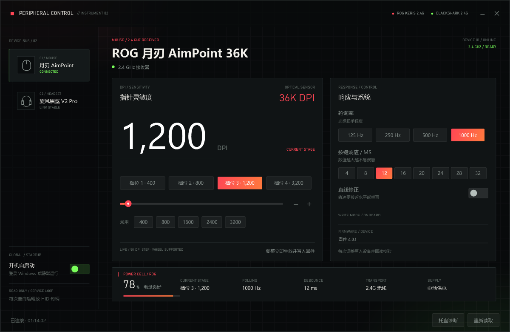

# ROG 月刃 控制中心

> English: [README.md](README.md)

Windows 10 下的罗技式轻量驱动替代：直接通过 ASUS 私有 HID 协议调节 ROG 月刃（Keris）
Wireless AimPoint 36K 的 DPI、轮询率、按键响应与直线修正，并读取电量。

另外新增了 **耳机** 页：只读显示雷蛇旋风黑鲨 V2 专业版（2023）通过 2.4G 接收器
（`1532:0555`）的电量与充电线状态。不提供蓝牙、EQ、麦克风、THX、灯效或固件修改。

- 无需安装 Armoury Crate，也不依赖 .NET SDK 或任何第三方运行库
- 单文件 exe，约 592 KB（内含 16–256 px 多尺寸图标与主视觉图），.NET Framework 4.x 自带环境即可运行
- **即时生效**：所有调整立刻写入鼠标并自动存进固件，没有「保存」按钮

## 使用方法

双击 `deliver\ROG鼠标控制中心.exe`（推荐，见下方「托盘图标与目录位置」），或把快捷方式放到桌面。



| 操作 | 说明 |
| --- | --- |
| 点击「档位 N」 | 真正切换到该 DPI 档并写入固件（鼠标上 4 档，等效于按滚轮下方的 DPI 键） |
| 拖动滑块 / 滚轮 / 点击 +- | 调整当前档位的 DPI，步进 50；松手立刻写入 |
| 「常用」行 | 一键把当前档位设为 400 / 800 / 1600 / 2400 / 3200 |
| 轮询率 | 125 / 250 / 500 / 1000 Hz，点中立刻写入 |
| 按键响应 | 4–32 ms 去抖，数值越小触发越快，点中立刻写入 |
| 直线修正 | 开启后移动轨迹更接近水平或垂直，切换立刻写入 |
| 开机自启动 | 应用内开关 + 托盘勾选项，写当前用户 HKCU Run 键，登录 Windows 时自动静默启动到托盘，不弹出主窗口，无需管理员权限；关闭即删除键值 |
| 重复启动 | 已有进程运行时再次双击 exe 不会新开进程，而是唤醒已运行窗口 |
| 重新读取 | 从鼠标重新读取全部状态 |
| 关闭按钮 / ESC | 收进系统托盘。窗口隐藏或最小化期间程序**完全不访问鼠标**（不轮询、不占用设备句柄），重新打开窗口时立刻读一次 |
| 托盘图标 | 环形显示当前电量：>=50% 绿、>=20% 黄、其余红；鼠标移到图标上看提示。窗口收起期间每 5 分钟自动刷新一次（全屏游戏时暂停刷新） |
| 托盘右键 | 显示主窗口 / 重新读取 / **开机自启动**（勾选项，与应用内开关联动）/ 退出 |
| 托盘诊断 | 底部按钮，把托盘的注册状态和图标位置写进脚注，同时记录到 `tray.log` |
| 鼠标 / 耳机 | 切换右侧设备页；耳机页选中时立即读取一次，之后每 60 秒刷新 |
| 耳机 · 重新读取耳机电量 | 只读查询耳机电量与充电线状态，读完立即释放 HID 句柄 |

## 雷蛇旋风黑鲨 V2 专业版（2.4G）

耳机通过 2.4G 接收器连接时，程序只接受同时满足以下条件的 HID 集合：Razer VID `1532`、
PID `0555`、产品名包含 `BlackShark V2 Pro`、用法页 `0xFF00`。这是为了避开同厂的鼠标、
键盘和另一个 `000C` 消费控制集合。

- **共享打开**：雷云保持开启也能读取；程序不抢占句柄，每次查询后立即关闭。
- **不是鼠标协议**：这个型号使用 64 字节 `PA` 帧，不能用雷蛇鼠标常见的 90 字节报告。
- `0x21` 返回电量 0–100；`0x2A` 返回 `0`（电池供电）或非零（已连接充电线）。
- 接收器会先推送无关的 `PI` 状态帧，程序只在命令回显和 ACK 匹配时采用读数。
- 耳机页不可见、窗口收起/最小化或全屏游戏在前台时，**不访问耳机**。
- 接收器在线但耳机没响应时，显示“接收器在线 · 耳机未响应”，不会把旧值当成当前电量。
- 充电字节只证明充电通路已连接；界面写“已连接充电线”，不声称电池正在充能。

协议事实参考 HaloBattery 的 MIT `providers/blackshark.py` 与 OpenRazer PR #2862
（同一 `1532:0555` 硬件）；只使用协议事实，不复制驱动代码，也不打包雷蛇软件。
该协议并非官方公开规范。

**即时生效**：每次调整都会立刻写入鼠标、回读校验、再写入固件，断电或换机都不会丢失。
拖动滑块时只在松手那一刻写一次；点击 chip、±、滚轮都是点完即写。
回读值和期望不一致时界面会直接报错，不会假装成功。

**切换生效档位**：点「档位 N」不只是选中要编辑的槽位，它会立刻把鼠标切到该档
（SET_SETTING 字段 9，值为 1–4 的档位号）并写入固件，断电后依然生效。
这是本项目实测挖出来的命令，libratbag 只读同一字节用于打 is_active 标记、从不写回。

## 设备访问策略（为什么不卡）

| 状态 | vendor 句柄 | 轮询 |
| --- | --- | --- |
| 窗口可见、无全屏程序 | 保持打开 | 每 60 s 一条电量命令（约 4–5 ms）；每 5 分钟一次全量读 |
| 窗口隐藏 / 最小化 / 在托盘 | **释放** | 停止，仅每 5 分钟一次 4–5 ms 电量读（刷新托盘电量） |
| 全屏程序在前台 | **释放** | 完全停止，连托盘保活也跳过 |

全屏检测每 3 s 做一次（`GetForegroundWindow` + 矩形 + 窗口样式，不碰设备），
所以全屏游戏期间程序对它所在的 HID 链路零流量。

## 托盘图标与目录位置

Windows 只允许**完整性级别不低于 Medium** 的进程向任务栏添加图标。如果 exe 所在的目录
带有 Low 完整性标签（Mandatory Label），从那里启动的进程就是 Low，`Shell_NotifyIcon` 会被
UIPI 直接拒绝并返回 `ERROR_ACCESS_DENIED (5)`，表现就是「程序能跑、但托盘里没有图标」。

- 交付用的 `deliver\` 目录是普通目录，从里面启动即可正常显示托盘图标
- 如果复制到别处后托盘消失，先点「托盘诊断」：脚注会写明当前的完整性级别
- 详细日志在 `%LOCALAPPDATA%\ROGMouse\tray.log`（该位置不可写时依次回退到 exe 同目录、临时目录），会记录 `NIM_ADD ok` / 失败错误码 / 图标坐标
- 托盘注册失败时**关闭窗口不会隐藏**，程序会保持窗口显示并给出提示，避免关掉后无路可回

## 环境要求

- Windows 10 / 11（x86 与 x64 系统均可，程序以 x86 编译）
- .NET Framework 4.5 以上（Win10 自带 4.8）
- 鼠标通过 2.4 GHz 接收器（USB PID `1A68`）或蓝牙（`1A66`）连接

## 协议说明

命令基于 libratbag（MIT）的 `src/asus.c`，并在本机对真机做了逐条验证：

| 命令 | 用途 |
| --- | --- |
| `0x0412` GET_SETTINGS | 参数 2 = 分离 XY 的 4 档 DPI；参数 0 = 轮询率/按键响应/直线修正 |
| `0x0012` GET_PROFILE | 当前 profile、当前生效档位、固件版本 |
| `0x0712` GET_BATTERY | 电量。**libratbag 中没有此命令，是本项目实测新增** |
| `0x3151` SET_SETTING | 写 DPI（字段 0-3）/ 轮询率（4）/ 按键响应（5）/ 直线修正（6）/ **当前生效档位（9）** |
| `0x0250` SET_PROFILE | 切换板载 profile（**不是** DPI 档位） |
| `0x0350` SAVE | 写入固件 |

DPI 换算：`dpi = 寄存器值 * 50 + 50`。

**响应帧的字节偏移**：响应前 2 字节是命令码回显，libratbag 的 `results[]` 数组从
第 3 字节（`raw[2]`）开始算。所以 libratbag 里的 `results[n]` 对应 `raw[n + 2]`：

| 字段 | libratbag | 实际字节 |
| --- | --- | --- |
| profile id | `results[8]` | `raw[10]` |
| 当前 DPI 档 | `results[9] - 1` | `raw[11] - 1` |
| 固件版本 | `results[4..2]` | `raw[6..4]` |

漏掉这 2 字节的偏移会让当前档位读成 6（被夹到最后一档），界面就会一直显示
3200 DPI，而鼠标实际在 1200。这个 bug 已修复。

电量帧形如 `12 07 00 00 62 01 0A 28 10 ...`（64 字节，已剥掉 report id），
第 5 字节（下标 4）是百分比。这个命令**不吃参数**，0-8 全部参数返回同一帧；
命令空间全扫（`0x00xx`-`0x30xx` x `0x12/0x13`）也没有额外的充电状态命令，
第 6 字节恒为 `01`、与是否插电无关。所以界面只显示电量与电量描述，
**不显示「充电中」**——这是本机真机实测的硬限制，不是界面偷懒。

## 两个实现上的坑

1. **必须用同步句柄**。这个 vendor collection 用 `FILE_FLAG_OVERLAPPED` 打开后，
   `WriteFile` 必然超时；`HidD_SetOutputReport` 直接返回错误 203。
   必须 `CreateFile` 不带 overlapped 标志，然后同步 `WriteFile` + `ReadFile`。
   代价是同步 `ReadFile` 会永久阻塞，所以用一个看门狗线程在超时后调
   `CancelSynchronousIo` 打断它（实测 19 ms 返回，无超时）。
2. **接口枚举**：只有 `usagePage = 0xFF01` 的那个接口能收发私有协议。
   `HidP_GetCaps` 的成功返回值是 `0x00110000` 而不是 0；
   `SetupDiGetDeviceInterfaceDetail` 里路径的偏移在 x64 是 8、x86 是 4。

## 目录结构

```
src/NativeMethods.cs     SetupAPI / HID / kernel32 的 P/Invoke
src/AsusHidDevice.cs     设备枚举与同步收发（含 CancelSynchronousIo 看门狗）
src/AsusProtocol.cs      命令封装与状态解析
src/Connection.cs        连接方式识别（2.4G / 蓝牙 / 有线）
src/AutoStart.cs         开机自启动（HKCU Run 键读写）
src/TrayIcon.cs          托盘图标、电量气泡与右键菜单
src/MainController.cs    界面与设备之间的绑定
src/App.cs               入口、DPI 感知、窗口图标、离屏渲染自检
ui/MainWindow.xaml       界面（无边框窗口 + 卡片布局）
ui/app.ico               程序图标，16/24/32/48/64/128/256 七个尺寸
ui/hero.png              左卡主视觉（按实拍照片风格化渲染的鼠标图）
ui/app.manifest          DPI 感知声明，缺它窗口会被系统拉伸放大
build/build.ps1          构建脚本
dist/                    编译产物
```

## 重新编译

用系统自带的 .NET Framework 编译器即可，不需要装 SDK：

```powershell
cd <项目目录>
$gac='C:\Windows\Microsoft.NET\assembly'
$a=@('/nologo','/target:winexe','/platform:x86','/out:dist\ROG鼠标控制中心.exe')
$a+='src\NativeMethods.cs','src\AsusHidDevice.cs','src\AsusProtocol.cs','src\Connection.cs','src\TrayIcon.cs','src\App.cs','src\MainController.cs'
$a+='/resource:ui\MainWindow.xaml,ui.MainWindow.xaml','/resource:ui\hero.png,ui.hero.png'
$a+='/win32icon:ui\app.ico','/win32manifest:ui\app.manifest'
$a+="/r:$gac\GAC_MSIL\PresentationFramework\v4.0_4.0.0.0__31bf3856ad364e35\PresentationFramework.dll"
$a+="/r:$gac\GAC_32\PresentationCore\v4.0_4.0.0.0__31bf3856ad364e35\PresentationCore.dll"
$a+="/r:$gac\GAC_MSIL\WindowsBase\v4.0_4.0.0.0__31bf3856ad364e35\WindowsBase.dll"
$a+="/r:$gac\GAC_MSIL\System.Xaml\v4.0_4.0.0.0__b77a5c561934e089\System.Xaml.dll"
& C:\Windows\Microsoft.NET\Framework64\v4.0.30319\csc.exe @a
```

注意：
- 这个 `csc.exe` 只支持 C# 5 语法（不能用 `out var`、字符串内插、`?.`）。
- `System.Windows.Forms` 与 `System.Drawing` **不要**手动 `/r:` 引用，
  csc 会自动带入；重复引用会报 `error CS1703: 已导入一个具有相同标识的程序集`。
- `/out:` 里的中文文件名**在交互式 / 内联 PowerShell 里完全正常**，上面这段直接粘到终端跑就行。
  只有当同一段命令被存成 `.ps1` 脚本文件再执行时才会因文件编码变成乱码；
  那种情况下的稳妥做法是先编译成 ASCII 名，再用 `Move-Item` 重命名。
- 换主视觉时直接替换 `ui/hero.png`（建议 1272×592，宽高比 2.15）再重新编译即可。
  `HeroImage` 上的 `HorizontalAlignment="Center" VerticalAlignment="Center"` 不能删：
  `Image` 默认把 `UniformToFill` 的溢出部分从左边裁起，会让人物整体偏右约 20 px。
- 左卡电量圆环占 128 px，靠底部对齐。上面「规格」区 `StackPanel` 的 `Margin="2,16,2,0"`
  与四行规格的 `Margin="0,0,0,10"` 是为它腾出空间用的，改大就会把圆环顶部裁掉。
